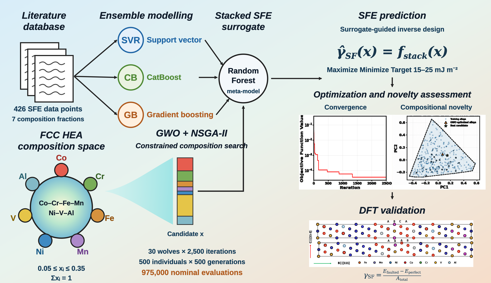

# HEAs-SFE

Code and data for machine learning prediction and inverse design of high-entropy alloys with targeted stacking fault energy.

## Files

- **Composition+SFE+Properties+Dataset.xlsx** — alloy compositions, SFE values, and physical-property descriptors.
- **SFE.ipynb** — regression model training, comparison, and stacked ensemble modelling.
- **PT.ipynb** — SFE prediction using power transformation and stacked regression.
- **Shap_SFE.ipynb** — SHAP analysis of feature contributions to predicted SFE.
- **use_it_20_25.ipynb** — Grey Wolf Optimizer composition search and novelty assessment.
- **20_25.ipynb** — genetic algorithm search for compositions within the target SFE range.
- **graphical_abstract.png** — overview of the research workflow.

Update dataset and saved-model paths before running the notebooks.

## Citation

If you use any of our code or data, please cite:

Debsundar Dey, Uddipta Panja, Renuka Kumari, Debdip Dutta, Hany S. Abdo, Asiful H. Seikh, and Manojit Ghosh. “Machine Learning Guided Composition Based Discovery of High-Entropy Alloys with Targeted Stacking Fault Energy.” Manuscript, 2026.

Please also cite the original dataset source identified in the manuscript when reusing the data.
